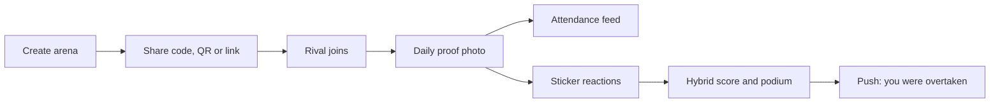

# Verdly Habits

**A habit tracker that doesn't take your word for it.**

Verdly turns habits into a game with witnesses. Start a challenge with friends, post one proof photo a day, and let a live leaderboard show who is actually showing up. It is also a full solo habit app (streaks, shields, goals, widgets), so it is a product you can live in on an ordinary Tuesday.

> **Shipaton 2026, Next Gen Award entry.** Built by Nick and Josh ([@nikko900](https://github.com/nikko900)) https://github.com/SmaddyJosh, founder of Saint Nico Labs and a Bachelor of Business Information Technology student, Thika, Kenya.

| | |
|---|---|
| **Demo video** | [VIDEO_URL](https://youtube.com/shorts/UiimDxnQsbI?si=gHwPQM_sKhEFA6Yg) |
| **Install the APK** | [GitHub Releases](https://github.com/nikko900/VerdlyHabits/releases) |
| **Google Play** | [PLAY_URL](https://play.google.com/store/apps/details?id=com.saintnico.verdlyhabits) (package `com.saintnico.verdlyhabits`, version 1.0.8) |
| **Website / invite pages** | [saintnico.site](https://saintnico.site) |
| **License** | [GNU General Public License v3.0](LICENSE) |

---

## Why this matters

Most habit apps are a private contract with yourself: tap done, close the app, nobody knows if you skip tomorrow. People start January strong and go silent by February. The exceptions are always social: the gym partner who texts "you coming?", the study group waiting at the library, the group chat that roasts whoever skipped.

Verdly puts that social pressure inside the product without turning it into a shame machine. Its most important screen is not a stats page. It is the attendance feed: **"2/5 showed up."**

---

## How to open and try the app (for judges)

You have three options, from fastest to most thorough.

### Option A: install the APK (about 2 minutes)

1. On an Android phone, open the [Releases page](https://github.com/nikko900/VerdlyHabits/releases) and download the latest `.apk`.
2. Open the file. If Android asks, allow installs from your browser or file manager ("Install unknown apps").
3. Launch **Verdly** and sign in with **email** (recommended for sideloaded builds) or Google.

The APK talks to the live Verdly backend, so all features work without any setup. If Google Sign-In fails on a sideloaded build, use email sign-in.

### Option B: Google Play

Install the published app from the [Play listing](https://play.google.com/store/apps/details?id=com.saintnico.verdlyhabits). This is the same product, version 1.0.8.

### Option C: build from source

See [Build from source](#build-from-source) below. This needs your own Firebase project, because the real Firebase config is deliberately not in this repo.

---

## A 5-minute tour

The arena is the main event, and it needs two accounts. Use two phones, or a phone plus an emulator.

1. **Create an arena.** Pick a habit name, a real-world stake (text, for example "loser buys lunch"), a duration (7, 14, 21, or 30 days), a daily clock, and a scoring mode.
2. **Share it.** Each arena gets a 6-letter code, a QR card, and a link (`saintnico.site/c/XXXXXX`). If a link opens the browser instead of the app on a sideloaded build, type the 6-letter code into the app.
3. **Join on the second device** with a different account.
4. **Post a proof photo** from both accounts. Watch the attendance row change from "Waiting" to "Planted" and the counter move to "2/2 showed up".
5. **React with stickers** on each other's proof. Hybrid scores move, the podium reorders, and "X score behind #1" updates.
6. **Try an oath.** Lock coins on your own consistency. New wallets start with a 20-coin first oath. Finishing converts the lock into trophy XP; missing forfeits half to the people still in. Coins can never be cashed out.
7. **Open the solo grove.** Plant a habit, check it off, and see the local-day streak. Look at streak shields, duo streaks, goals, trophies, and the home screen widgets.
8. **See Premium.** The paywall is contextual (at seven days, at a loss, and when a shield could still save you). See the demo video for the purchase flow.



---

## Features

**Arena (social challenges)**
- Invite by 6-letter code, QR card, or link that auto-joins after sign-in
- One proof photo per day, with a strict clock and a late window (midnight to 3am) that never extends the streak
- Weighted stickers (+3, +2, +1) with anti-farming limits: no self-hype, 10 reactions per day per challenge
- Three scoring modes: Consistency Cup (longest streak), Crowd Favourite (reaction points), Hybrid (`streak * 10 + reaction points`) with deterministic tie-breaks (points, then streak, then uid)
- Rank-change push notifications from Cloud Functions, using the same scoring formula as the app
- Result snapshot when an arena ends: winner title, final board, top posts

**Solo grove**
- Streaks that belong to your real local day, not UTC, frozen at write time so travel cannot rewrite yesterday
- Streak shields that bridge a missed day without faking a completion
- Duo streaks with named milestones, and "swap a day" gifting
- Goals (build, quit, maintain) with confirmations and urge check-ins
- Home screen widgets (Glance) and Wrapped
- Trophies (50+, total count hidden), badges, and titles; none can be bought

**Coins and oaths**
- Coins are recognition, never cash: there is no withdraw path anywhere in the economy
- Lock 10 coins or more (up to 50% of your wallet) on yourself; convert to trophy XP on finish, forfeit to the group on a miss
- Gifting and Grove cosmetics between friends

---

## RevenueCat

Verdly uses the **RevenueCat SDK** for in-app purchases:

- **Premium** entitlement: unlimited habits, focus sounds, deeper analytics, streak shields, and a monthly coin drip
- **Coin purchases** for the coin economy
- Contextual paywall moments (day seven, after a lost streak, when a shield could still save you) instead of a generic "go pro"

Where to look in the code:

- `app/src/main/java/com/saintnico/verdlyhabits/billing/RevenueCatBootstrap.kt`: SDK setup and entitlement handling
- `app/src/main/java/com/saintnico/verdlyhabits/ui/components/RevenueCatProPaywallDialog.kt`: the paywall UI
- `app/src/main/java/com/saintnico/verdlyhabits/domain/MembershipStatusResolver.kt`: turns entitlement state into what the app unlocks

---

## Tech stack

Kotlin 2.0, Jetpack Compose (Material 3, Navigation Compose), Room, DataStore, WorkManager, Glance (widgets), Coil, Lottie, Konfetti, ZXing (QR), Firebase (Authentication, Cloud Firestore, Storage, Cloud Messaging), Cloud Functions (Node 20, `firebase-admin`, `firebase-functions` v2), RevenueCat, Google Play Billing.

---

## Interesting engineering

- **Private rooms with public invites.** Firestore `list` queries are checked against the query, so a joiner cannot search a members-only collection by code. Invites are a separate `invites/{CODE}` mapping that can be read by id, so a link admits someone to one challenge without exposing any other. See `firestore.rules`.
- **One scoring contract, two places.** The Kotlin scoring code and the Cloud Functions copy use the same formula and tie-breaks, so a notification can never disagree with the leaderboard.
- **Local-day streaks.** Completions are stored as "this habit, this local date". A `DayChangeCoordinator` re-evaluates on calendar day, timezone, and boot.
- **Transactions for reactions and check-ins**, so two phones cannot double-spend points.
- **Idempotent oath conversion and forfeit**, so retries never pay twice.
- **Social contract before machine learning.** Proof is one photo per day, a clock, a report button, and friends who know your face. We chose not to fake verification in v1.

---

## Build from source

The real `google-services.json` is intentionally not committed. You need your own Firebase project.

**Prerequisites:** Android Studio (latest stable), a Firebase project, Node 20 and the Firebase CLI (only for the backend), and a RevenueCat account (only to test purchases).

1. **Clone**
   ```
   git clone https://github.com/nikko900/VerdlyHabits.git
   cd VerdlyHabits
   ```
2. **Firebase.** Create a project, add an Android app with package `com.saintnico.verdlyhabits`, and enable Authentication (Google and Email), Cloud Firestore, Storage, and Cloud Messaging. Add your debug SHA-1 for Google Sign-In. Download `google-services.json` into `app/`. A template is at `app/google-services.json.example`.
3. **Keys.** Copy `keystore.properties.example` to `keystore.properties` only if you plan to build a signed release. Add your RevenueCat public SDK key where the build reads it (see `app/build.gradle.kts`).
4. **Backend rules and functions** (needed for the arena, invites, and push notifications):
   ```
   firebase deploy --only firestore:rules,storage
   cd functions && npm install && cd ..
   firebase deploy --only functions
   ```
   Cloud Functions require the Firebase Blaze plan.
5. **Build and run**
   ```
   ./gradlew assembleDebug
   ```
   Or press Run in Android Studio.
6. **Unit tests**
   ```
   ./gradlew testDebugUnitTest
   ```

---

## Repository layout

```
app/src/main/java/com/saintnico/verdlyhabits/
  challenge/, ui/screens/arena/     Arena logic and screens
  streak/, data/streak/, domain/    Streak engine, shields, day-change handling
  data/coins/, data/local/coins/    Coin wallet, oaths, gifts
  billing/                          RevenueCat and purchase flow
  engine/                           Trophies, insights, goals, share cards
  data/remote/                      Firebase repositories (auth, Firestore)
  notifications/, widget/, workers/ Push, Glance widgets, background sync
  ui/                               Compose screens, components, theme
app/src/main/res/                   Resources, Lottie animations, translations (en, de, es, sw)
app/src/test/                       Unit tests
functions/                          Cloud Functions (rank push notifications)
web/                                Invite landing page (saintnico.site)
firestore.rules, storage.rules      Security rules
play_store_assets/                  Store listing assets
```

---

## What's next

Server-authoritative daily clock, team-versus-team arenas, optional proof assistance with humans still able to report, arena streak recovery, and iOS. We will not add cash-out. That is a promise in the coin model.

---

## License

Released under the [GNU General Public License v3.0](LICENSE).
